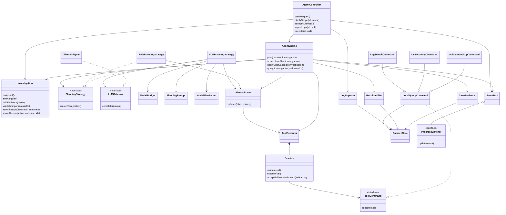

# Current implementation architecture

For operating instructions, see the [GUI user guide and behaviour reference](gui-user-guide.md) and [CLI user guide and command reference](cli-user-guide.md). These describe the current interface contracts separately from the service architecture below.

The single-user composition is ApplicationSession -> shared ActionDispatcher/AgentController -> AgentEngine and Investigation. Both views use the same controller. DatasetStore supplies immutable retained source versions, JsonCaseRepository saves aggregate snapshots and ReportService exports accepted values.

AgentEngine.run independently validates a READY plan, opens one scoped executor session and shares the planning ModelBudget with analysis. Eight tool attempts, six model calls, two plan revisions and provider/tool deadlines bound execution. Accepted event indicators may extend the visible plan; counters and duplicate history remain in the same session. Failures preserve accepted evidence and deterministic analysis as PARTIAL; fatal application errors are explicit FAILED. Stop is cooperative after the current operation.

AnalysisService derives timeline and policy-v1 Facts from canonical sources. R1/R2/R3/R4 contribute 2/3/2/1 once. Compact model refs map to canonical evidence UUIDs, including optional contradictions. Both compact and full structured synthesis receive schema/citation checks and one bounded repair. No model score or executable response action is accepted. Model context is capped at 24 source items, candidate relationships at 1000 pairs.

Persistence uses closed record JSON, duplicate-key/trailing/type rejection, bounded UTF-8 reads and atomic writes. Dataset snapshots retain all historical versions and source-dated feed provenance. Case locks reject competing/stale writes; restored RUNNING becomes PAUSED. Source availability is checked before retrieval, while unavailable archived cases remain inspectable. Use one dataset writer at a time; case and dataset files are separately atomic.

Swing renders saved values in Plan, Evidence, Timeline, Hypotheses, Assessment, Conversation, History and Report tabs. Background workers route Actions through the same dispatcher as CLI. CLI emits JSON Result envelopes and stderr progress; successful mutations and failed follow-up records save automatically. Critical-host inventory is explicit per run/process.

Updated UML: [class model](uml/implemented-system.puml), [runtime sequences](uml/runtime-sequences.puml), and the three PNG class views. The Stage 1 use-case actors/goals are retained; no features or patterns are replaced.

## Earlier service architecture through Steps 9–12

This describes implemented service collaborations. Swing/CLI views, model analysis,
autonomous orchestration, persistence and both interfaces are now connected.

| Boundary | Implemented behavior | Evidence |
| --- | --- | --- |
| MVC application/model | Controller owns one active case; engine and importer update the aggregate; views use the shared dispatcher | ApplicationFlowTest |
| Strategy | Engine delegates to model/rule strategies and independently validates output; model repair/budgets and explicit rule approval are enforced | PlanningTest, ApplicationFlowTest |
| Command | Scoped session validates and dispatches read-only concrete queries; result sources are checked before attachment | ToolExecutorTest, ApplicationFlowTest |
| Observer | Immutable progress values, independent listeners and callback failure isolation | EvidenceIntegrationTest, ApplicationFlowTest |
| Adapter | Bounded Ollama HTTP requests, response parsing, typed errors and complete-body timeouts; real service unavailable | OllamaAdapterTest, ModelPlanningTest |

Import is synchronous: controller preflights the case before LogImporter stages/validates input,
DatasetStore atomically publishes its version, and Investigation records the summary.
A changed version invalidates the plan and old engine sessions, marks assessment stale, and keeps
historical evidence. Rejected/unchanged duplicate imports preserve the prior version and analysis.

Retrieval binds a session to case identity and immutable scope. After dispatch, ResultVerifier
checks source identity, payload, provenance, query scope/filters and metadata. Investigation
atomically accepts unique records and audits their IDs. CaseEvidence resolves only accepted,
canonical in-scope event records to authorize enrichment in the same session; budget and duplicate
history are preserved. A manual query starts its own operation budget; autonomous collections
must keep one session.

Planning requires complete scope and explicit approval for a RULE plan. PlanValidator enforces
the real registry/scope constraints, unique canonical calls, configured size, revisions 0–2 and
prerequisites referring to earlier steps. Plan.next observes those prerequisites. Neither rule
planning nor validation executes retrieval. MODEL origin in a proposal is metadata, not evidence
that real inference occurred: integration is implemented, but tests use fake servers and the local real-service check failed.

Snapshots retain target type/feed selection and plans retain origin/prerequisites. Backward
Java constructors preserve earlier component callers; no durable case files exist to migrate yet.
The future JSON repository must serialize and validate these fields. Controller save/open/export
route through ports; their concrete file implementations are not supplied by these increments.

The model Strategy uses a bundle-owned planning-v1 template and JSON-encoded case context.
Only allowed registry tools, selected scope/feed and accepted indicators can authorize proposed
calls. ModelPlanParser rejects unsupported fields and assigns application-owned UUID/revision/origin.
One repair and one transient retry per planning operation share ModelBudget; autonomous run
integration must pass the same six-call counter to later model work rather than recreate it.

OllamaAdapter performs one non-streaming /api/generate attempt with request/response byte caps,
strict completion-envelope parsing, no redirects and one end-to-end timeout covering the body.
Provider failures remain typed and sanitized. Caller interruption cancels the pending request and
preserves the interrupt flag. Successful accepted model plans record known model/prompt identifiers;
fake transport verification does not establish actual Qwen generation or usage.
Saved PAUSED cases explicitly revalidate their unchanged plan through AgentController.resume / AgentEngine.revalidate. This works at revision 2 without another model call or plan revision reset.
